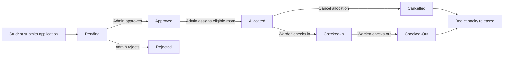
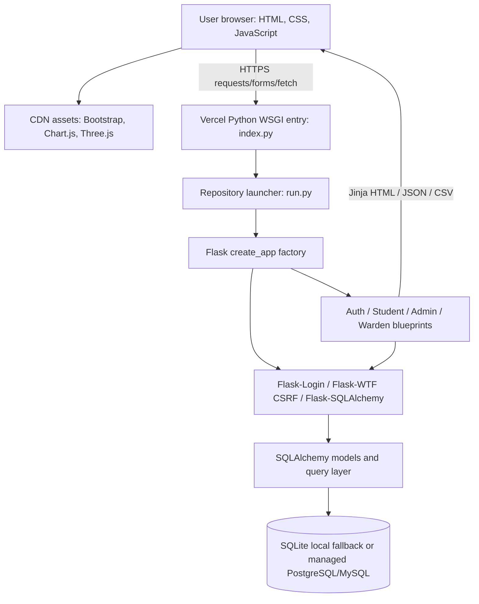
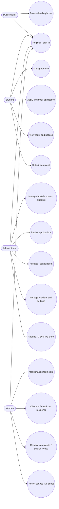
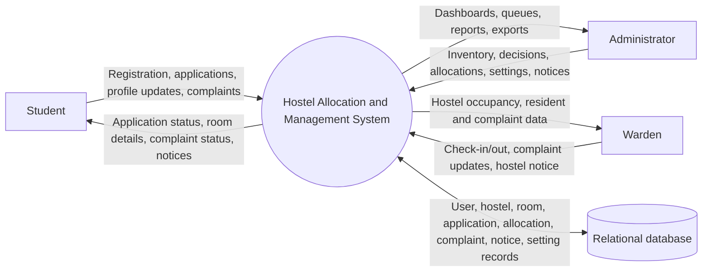
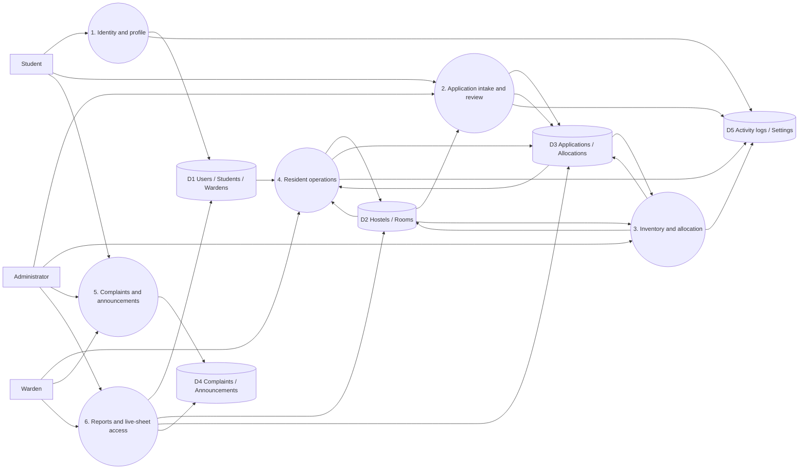
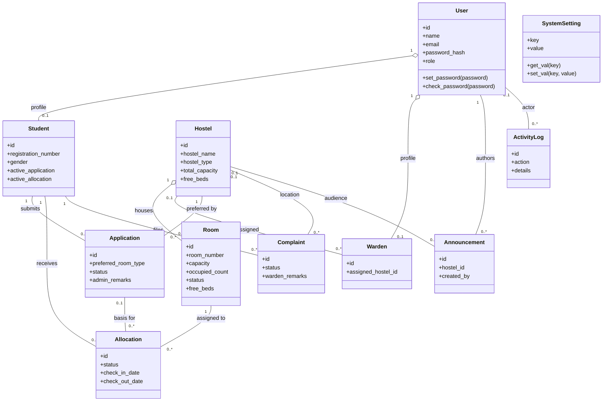
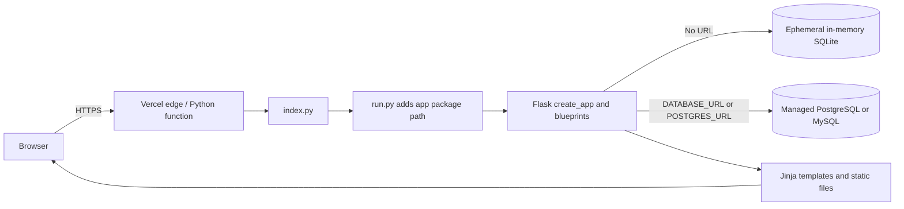

# Hostel Allocation and Management System
## Project Requirements Document and Implementation Guide

**Document version:** 1.0  
**Prepared:** 16 November 2026  
**Document type:** Academic project PRD / software implementation reference  
**Source of truth:** Current Flask application, SQLAlchemy models, MySQL DDL/seed scripts, templates, and test suite in this repository.

> This document describes what the code implements today. Items labelled **Recommended** are target requirements or future work, not claims that the feature already exists. The ORM model is the runtime schema source when the application starts; `database/schema.sql` is a separate MySQL-specific DDL artifact and is not automatically applied by the Flask application.

---

## 1. Executive summary

The Hostel Allocation and Management System (HAMS) is a server-rendered web application for managing student accommodation. It provides three authenticated portals: **Student**, **Administrator**, and **Warden**. Students register, maintain their profile, apply for accommodation, track decisions, view allocations and notices, and submit complaints. Administrators maintain the hostel and room inventory, review applications, assign rooms, manage wardens and notices, review complaints, export reports, and edit selected records through a live-sheet interface. Wardens oversee one assigned hostel, manage check-in/check-out, monitor occupancy, resolve complaints, publish hostel notices, and edit a restricted subset of data.

The backend is built with Flask and Flask-SQLAlchemy. Flask-Login manages browser sessions; Flask-WTF provides forms and CSRF protection. The UI uses Jinja templates, CSS, JavaScript, Bootstrap, Chart.js, and Three.js. The code supports SQLite for local/demo operation and accepts PostgreSQL or MySQL URLs through SQLAlchemy configuration. For Vercel, a root-level WSGI entrypoint (`index.py`) delegates to the existing launcher and factory.

### 1.1 Business objectives

1. Maintain one shared record of hostels, rooms, students, applications, allocations, complaints, notices, and configuration.
2. Make application review and room allocation traceable and capacity-aware.
3. Give students visibility into application, room, complaint, and announcement status.
4. Give wardens operational tools scoped to their assigned hostel.
5. Provide administrators with operational dashboards, reports, audit events, and controlled data editing.

### 1.2 Success criteria

The current implementation can be considered functionally successful when:

- Students can register, log in, submit and track applications, view an allocation, and lodge a complaint.
- Administrators can review applications, allocate only to eligible available rooms, manage hostel inventory, and export reports.
- Wardens can see only their assigned hostel's operational data and perform check-in/check-out and complaint updates.
- Active application and active allocation checks are enforced by application logic, and bed counts are released when an allocation ends.
- Existing automated tests pass and the configured WSGI entrypoint can render the public landing page.

The checked-in test suite contains 12 functional/security/transaction tests. A prior local run completed with **12 passed**; this confirms the covered local SQLite behaviors, not production database connectivity or a live Vercel deployment.

---

## 2. Project overview, scope, and stakeholders

### 2.1 In scope

- Public landing and about pages.
- Student account registration, sign-in/out, profile maintenance, accommodation applications, room/allocation status, complaints, and announcements.
- Administrator management of students, hostels, rooms, applications, allocations, wardens, complaints, announcements, institutional settings, dashboard metrics, CSV reports, and live-sheet data.
- Warden dashboard, assigned-hostel overview, occupancy, resident roster, check-in/out, complaint handling, hostel announcements, and scoped live-sheet access.
- SQL-backed relational persistence, local SQLite fallback, automatic table creation, and demo fixture seeding when the database is empty.
- Browser-rendered UI with responsive styling, charts, and 3D hostel/room visualizations.

### 2.2 Out of scope in the current code

- Payment collection, deposits, invoices, refunds, or billing.
- Automated email/SMS/push notifications.
- Identity federation, institutional SSO, MFA, or external directory integration.
- Document upload and verification workflows.
- A separately versioned public REST API or API-token authentication.
- Automated room-transfer workflow, waitlist engine, or optimization-based allocation.
- Production backup/restore orchestration, observability dashboards, or database migrations.

### 2.3 User roles

| Role | Primary goals | Authorization boundary |
|---|---|---|
| Student | Maintain profile, apply for a room, track status, see room, raise complaint, read notices | Own profile, applications, and complaints; portal endpoints require `student` role |
| Administrator | Operate the whole accommodation program and manage records | System-wide access; portal endpoints require `admin` role |
| Warden | Operate assigned hostel and coordinate resident services | Application checks `assigned_hostel_id` for sensitive actions and scopes data queries to that hostel |
| Public visitor | Learn about hostels and view public landing/about content | Unauthenticated access to public pages only |

---

## 3. Functional requirements

The identifiers below are documentation IDs for the behaviors present in the repository.

| ID | Requirement | Current implementation evidence |
|---|---|---|
| FR-01 | Provide a public landing page with hostel, student, room, and capacity summary and 3D preview. | `auth.landing`; Jinja landing template; Three.js viewer |
| FR-02 | Provide a public about page. | `auth.about` |
| FR-03 | Authenticate all three roles using email and password, with optional remembered session. | Flask-Login; `LoginForm`; Werkzeug password hash verification |
| FR-04 | Allow public student registration with profile fields, unique email/registration number checks, and password confirmation. | `StudentRegistrationForm`; registration route creates linked `User` and `Student` |
| FR-05 | Provide demonstration role sign-in for seeded demo accounts. | `/demo-login/<role>` route and demo account map |
| FR-06 | Enforce role checks on student, administrator, and warden portal routes. | `role_required` decorator plus `login_required` |
| FR-07 | Allow students to view and edit profile attributes. | Student profile GET/POST route and form |
| FR-08 | Let students apply to a gender-eligible hostel and select a preferred room type. | Student application route filters hostels by gender/co-ed and validates eligibility |
| FR-09 | Prevent a student with an active application or active allocation from submitting another application. | `active_application` and `active_allocation` properties plus route checks |
| FR-10 | Respect institutional intake status when accepting new applications. | `SystemSetting` key `intake_status`; application route rejects when `Closed` |
| FR-11 | Let students track all application statuses and administrative remarks. | Student applications page and `Application` model |
| FR-12 | Let students view their current room and allocation/check-in status. | Student room page and `active_allocation` property |
| FR-13 | Let students file complaints and view their complaint history/status. | Student complaints route and `Complaint` model |
| FR-14 | Display global and hostel-specific announcements to the relevant portals. | `Announcement.hostel_id` nullable; student and warden query/filter logic |
| FR-15 | Provide administrator dashboard counts, recent queue data, and chart datasets. | `admin.overview`; rendered dashboard with Chart.js |
| FR-16 | Let administrators search/filter students, rooms, applications, and manage hostel inventory. | Admin list/create/edit/delete routes and templates |
| FR-17 | Let administrators approve/reject pending applications and store remarks. | `admin.decide_application`; status limited to Approved/Rejected |
| FR-18 | Allocate an approved application to a room only if the room is not in maintenance or full and the student has no active allocation. | `admin.allocate_room`; increments occupancy, creates allocation, updates application, logs, commits/rolls back |
| FR-19 | Cancel an active allocation and release room capacity. | `admin.cancel_allocation`; marks allocation Cancelled and application Approved |
| FR-20 | Create/edit/delete wardens and assign a hostel. | Admin warden management routes |
| FR-21 | Let administrators and wardens review/update complaints. | Admin complaint routes; warden update route enforces assigned-hostel match |
| FR-22 | Let administrators publish global or hostel-specific notices and wardens publish only to their own hostel. | Announcement forms/routes; warden audience is set to assigned hostel |
| FR-23 | Let wardens view hostel occupancy, active residents, and recent check-outs. | Warden dashboard, occupancy, residents, and check-in pages |
| FR-24 | Let wardens check residents in/out; check-out releases a bed. | Warden check-in/out action route, scoped by room hostel |
| FR-25 | Let administrators export occupancy, student/allocation, and room inventory CSV reports. | `/admin/reports/export/<report_type>` |
| FR-26 | Provide role-specific live-sheet JSON data and inline updates. | Admin and warden `/api/sheet/data` and `/api/sheet/update` routes |
| FR-27 | Restrict warden live-sheet records and updates to the warden's assigned hostel. | Warden data query filters and record-level authorization checks |
| FR-28 | Record selected actions for operational audit visibility. | `ActivityLog`; registration/login, application, decision, allocation, check-in/out, and complaint flows log events |
| FR-29 | Allow administrators to edit institutional settings stored as key/value records. | Settings form and `SystemSetting` get/set methods |

### 3.1 Core workflow and state transitions

**Application lifecycle:** `Pending` → `Approved` or `Rejected`; an approved application becomes `Allocated` after room assignment. Cancellation of an allocation resets its linked application to `Approved`.

**Allocation lifecycle:** `Allocated` → `Checked-In` → `Checked-Out`, or active allocation → `Cancelled`. Both check-out and cancellation decrement `Room.occupied_count`; a previously full room returns to `Available`.

**Complaint lifecycle:** `Open` → `In Progress` → `Resolved` or `Closed`. The code accepts these values in the warden complaint update form and stores optional remarks.

---

## 4. Non-functional requirements

The left column captures current behavior. The targets are **recommended acceptance targets** for a production deployment; the repository does not contain load, availability, or accessibility measurements that establish these values today.

| Area | Current state | Recommended target / acceptance criterion |
|---|---|---|
| Security | Werkzeug password hashing; role decorator; CSRFProtect; `HttpOnly` and `SameSite=Lax` session cookies. No explicit CSP or `Secure` cookie setting is present. Demo-login route exists. | Production secret is a strong managed value; HTTPS-only secure cookies; disable demo-login; validate/limit all live-sheet fields server-side; add reviewed CSP; security test role and CSRF boundaries. |
| Persistence | Config accepts PostgreSQL/MySQL URLs; absent URL defaults to in-memory SQLite. Vercel filesystem/process memory is ephemeral. | Use managed PostgreSQL/MySQL for production and test cold starts/restarts against it. Maintain backups and a migration plan. |
| Reliability | Allocation/check-in operations commit or roll back around updates. Some catches convert exceptions to UI messages. No health/readiness endpoint is defined. | Add health checks, structured error logging, database connection monitoring, and concurrency tests for simultaneous allocations. |
| Performance | ORM queries are rendered per request; dashboards calculate aggregate values from records. No pagination is consistently evident. | Agree on production scale; target p95 page response below 2 seconds at expected load; add indexes/pagination and query profiling as data grows. |
| Scalability | Vercel Python serverless entrypoint supports request-based scale; sessions are Flask signed-cookie sessions. | Keep state external (managed DB); use connection pooling suitable for serverless; avoid relying on process memory. |
| Compatibility | HTML/CSS/JS with CDN-loaded Bootstrap 5.3.3, Bootstrap Icons 1.11.3, Chart.js 4.4.1, Three.js r128. | Support current Chrome, Edge, Firefox, Safari and mobile layouts; pin/upgrade and smoke-test CDN dependencies. |
| Accessibility | Semantic templates and responsive styling exist; no formal accessibility test evidence. | Meet WCAG 2.1 AA for keyboard access, labels, contrast, focus, and chart/3D alternatives. |
| Maintainability | Blueprints, forms, model classes, templates, tests, and SQL scripts are separated. `create_all()` is used; no migration framework is present. | Add Alembic/Flask-Migrate, explicit service layer for allocation rules, lint/type checks, and documented migration ownership. |
| Data integrity | ORM unique constraints on user email, student registration number, hostel name, room per hostel; route-level business checks. SQL file additionally has checks/generated columns not reflected in ORM. | Make runtime schema and DDL consistent; enforce active application/allocation uniqueness and room bounds in the production database. |

---

## 5. System architecture

### 5.1 Logical architecture

### 5.2 Deployment request path

At the repository root, `index.py` imports the WSGI `app` exported by `run.py`. The root launcher adds `hostel_allocation_system/` to `sys.path`, imports `app.create_app`, and creates the Flask application. The factory configures extensions, registers blueprints, runs `db.create_all()`, and invokes demo seeding if the database has no users and the app is not in testing mode. Vercel serves the WSGI application using its Python runtime. Locally, the nested `hostel_allocation_system/run.py` can also start Flask directly.

The current optional database configuration has two operating modes:

1. **No database environment variable:** `sqlite://` in-memory database, useful for local/demo startup but not durable on serverless infrastructure.
2. **Configured `DATABASE_URL` or `POSTGRES_URL`:** PostgreSQL or MySQL SQLAlchemy driver is selected by URL normalization. Connection/schema errors are not silently switched to another database.

### 5.3 Use case diagram

### 5.4 DFD Level 0 (context diagram)

### 5.5 DFD Level 1

---

## 6. Database design

### 6.1 Entity relationship diagram

This ER diagram is embedded as an image so Markdown viewers do not need Mermaid support. Repeated table labels in different panels refer to the same database entity; the relationship cardinalities and complete field descriptions follow below.

### 6.2 Runtime ORM table summary

| Table / model | Main fields and rules | Relationships / role in workflow |
|---|---|---|
| `users` / `User` | Integer ID, name, unique/indexed email, password hash, role enum (`student`, `warden`, `admin`), created timestamp | One-to-one optional student and warden profiles; creator/user for notices and logs |
| `students` / `Student` | User FK unique, unique/indexed registration number, phone, department, year, gender enum, address | Many applications, allocations, and complaints; computed `active_application` and `active_allocation` query properties |
| `wardens` / `Warden` | User FK unique, phone, nullable assigned-hostel FK | Identifies warden scope; nullable assignment supports unassigned warden screen |
| `hostels` / `Hostel` | Unique name, type enum (`Boys`, `Girls`, `Co-ed`), address, total_rooms, description | Parent to rooms; related wardens, applications, complaints, and notices; computed total capacity/occupied/free beds |
| `rooms` / `Room` | Hostel FK; room number; type enum; capacity; occupied_count; status enum (`Available`, `Full`, `Maintenance`) | Unique constraint on `(hostel_id, room_number)`; parent to allocations; `free_beds` is computed |
| `applications` / `Application` | Student FK, preferred-hostel FK, preferred-room enum, date, status enum, admin remarks | Application queue; allocation can reference an application. Application status represents the review/allocation lifecycle |
| `allocations` / `Allocation` | Student FK, room FK, nullable application FK, allocation/check-in/check-out timestamps, status enum | Active allocation is status `Allocated` or `Checked-In`; occupancy counter is updated by routes |
| `complaints` / `Complaint` | Student FK, nullable hostel FK, title, description, date, status enum, warden remarks | Warden filtering by hostel; hostel becomes nullable if a referenced hostel is removed (`SET NULL`) |
| `announcements` / `Announcement` | Title, description, nullable hostel FK, creator-user FK, timestamp | `hostel_id = NULL` means system-wide notice; otherwise hostel-scoped |
| `activity_logs` / `ActivityLog` | Nullable user FK, action, details, timestamp | Audit/event history for selected key actions; user may be nulled on user deletion |
| `system_settings` / `SystemSetting` | Unique key, string value, updated timestamp | Key/value settings, including intake status and institution/term settings |

### 6.3 Relationship cardinalities

The relationship diagram repeats some entity boxes across panels to keep edges readable. Repeated labels refer to the same table. Cardinalities below follow the current ORM foreign keys and nullable/unique declarations.

| Parent / referenced entity | Dependent entity | Cardinality | Implementation detail |
|---|---|---|---|
| User | Student | 1 to 0..1 | `students.user_id` is a unique, non-null foreign key |
| User | Warden | 1 to 0..1 | `wardens.user_id` is a unique, non-null foreign key |
| Hostel | Room | 1 to 0..* | `rooms.hostel_id`; room number is unique within a hostel |
| Hostel | Warden | 1 to 0..* | `wardens.assigned_hostel_id` is nullable |
| Student | Application | 1 to 0..* | `applications.student_id` is non-null |
| Hostel | Application | 1 to 0..* | `applications.preferred_hostel_id` is non-null |
| Student | Allocation | 1 to 0..* | `allocations.student_id` is non-null; active allocation limit is route logic in ORM runtime |
| Room | Allocation | 1 to 0..* | `allocations.room_id` is non-null |
| Application | Allocation | 1 to 0..* | `allocations.application_id` is nullable and not unique in the ORM |
| Student | Complaint | 1 to 0..* | `complaints.student_id` is non-null |
| Hostel | Complaint | 0..1 to 0..* | `complaints.hostel_id` is nullable |
| User | Announcement | 1 to 0..* | `announcements.created_by` is non-null |
| Hostel | Announcement | 0..1 to 0..* | `announcements.hostel_id` is nullable; null means global notice |
| User | ActivityLog | 0..1 to 0..* | `activity_logs.user_id` is nullable |
| — | SystemSetting | Independent | Key/value row has no foreign-key relationship |

### 6.4 Relationships and deletion semantics

- Deleting a user cascades to its student or warden profile at the ORM/DDL level.
- Deleting a student cascades to that student's applications, allocations, and complaints in the declared relationships/SQL DDL.
- Deleting a hostel cascades to rooms and hostel-targeted announcements in SQL DDL; wardens assigned to it become unassigned. Application references to a hostel do not declare cascade in the DDL.
- Deleting a room referenced by an allocation is restricted by the SQL FK unless allocations are removed or reassigned; admin route additionally blocks deleting occupied rooms.
- Deleting an application sets an allocation's application reference to null in the SQL DDL.
- Deleting a user referenced by an activity log sets `activity_logs.user_id` to null in the SQL DDL.

### 6.4 ORM versus SQL DDL caveat

The live Flask factory imports models and runs SQLAlchemy `db.create_all()`. It does **not** execute `database/schema.sql` or `database/seed.sql`. The SQL file is MySQL 8.0.16+-specific and contains database-level room capacity `CHECK` constraints and generated `active_student_id` columns with unique indexes for active application/allocation rules. Those generated columns and check constraints are **not present in `app/models.py`**. The ORM has route/property checks and room-per-hostel uniqueness, but its runtime-created schema does not gain the SQL file's additional uniqueness/check rules. `create_all()` also does not alter an existing schema; a migration is required to evolve deployed databases safely.

`seed_demo.py` seeds its own demo set (currently two hostels and associated records) when no users exist. `database/seed.sql` is a separate MySQL fixture set (three hostels). `seed.py` is also present for manual database setup. These seed sources should not be treated as identical datasets.

---

## 7. UML class diagram

The diagram shows the principal model relationships and representative responsibilities; it is a domain view, not a reproduction of every method.

---

## 8. Module-wise implementation

### 8.1 Shared application and authentication

`app/__init__.py` creates the Flask instance, loads `Config`, initializes `db`, `login_manager`, and `csrf`, imports/registers four blueprints, creates tables, optionally seeds demo records, and registers 403/404/500 handlers, a context processor, and a status badge filter. `app/extensions.py` owns extension instances so blueprints/models share them without creating duplicate objects.

`app/auth/` provides public landing/about, registration, login, demo login, and logout. Successful registration creates `User`, flushes for its ID, creates `Student`, logs the event, and commits. Login normalizes email to lowercase and verifies the stored Werkzeug hash. Flask-Login reloads a user from its ID through the app-level `user_loader`.

### 8.2 Student portal

The student blueprint is mounted at `/student`. Its routes provide overview, profile, apply, applications, room, complaints, and announcements pages. `get_current_student()` resolves the student profile associated with the signed-in user. Application selection is filtered by gender (male: Boys/Co-ed; female: Girls/Co-ed; Other: all), then revalidated on submission. Intake status, active application, and active allocation checks prevent ineligible duplicate submissions. Student templates display status and room information; forms use Flask-WTF validators and CSRF.

### 8.3 Administrator portal

The admin blueprint is mounted at `/admin`. It supports dashboard metrics/charts; student list/delete; hostel create/edit/delete; room list/create/edit/delete; application review and decisions; room allocation/cancellation; warden create/edit/delete; complaint status updates; global or hostel announcements; CSV reports; institutional settings; and all-record live-sheet JSON reads/updates.

Allocation is implemented in the route rather than a separate service. It checks approved application status, active allocation absence, room maintenance status, and free capacity, then updates `Room.occupied_count`, room status, application status, `Allocation`, and `ActivityLog` in one SQLAlchemy session commit. Exceptions trigger rollback. This is transaction-scoped, but robust protection from concurrent allocation races still requires database-level constraints/locking and a concurrency test.

### 8.4 Warden portal

The warden blueprint is mounted at `/warden`. It resolves the warden profile and assigned hostel. Unassigned wardens receive a dedicated view. Occupancy, residents, check-in/out, complaints, notices, and live-sheet results are scoped to the assigned hostel. Check-in/out and complaint updates validate target record ownership before mutation. Check-out decrements room occupancy; warden live-sheet editing is limited to room status/capacity and complaint status/remarks as allowed by the update route.

### 8.5 Frontend and templates

Jinja templates are separated by `auth`, `student`, `admin`, `warden`, and `shared` folders. Shared CSS provides the design system. `main.js` handles common UI interactions and chart setup; `three_viewer.js` creates the architectural visualizations; `live_sheet.js` fetches JSON, renders editable tables, submits updates with an `X-CSRFToken` header, and exports sheet data as CSV. Third-party UI/visualization libraries are loaded from public CDNs in `shared/base.html`.

---

## 9. API and authentication

The application is primarily a browser-rendered HTML application using form submissions. The following same-origin JSON routes power the live-sheet UI; they are not a separately versioned external API.

| Method | Path | Role | Response / purpose |
|---|---|---|---|
| GET | `/admin/api/sheet/data` | Admin | JSON collections for students, hostels, rooms, applications, allocations, complaints, wardens |
| POST | `/admin/api/sheet/update` | Admin | Update an allow-listed field on supported records; JSON success/error response |
| GET | `/warden/api/sheet/data` | Warden | JSON rooms, allocations, complaints for assigned hostel only |
| POST | `/warden/api/sheet/update` | Warden | Update authorized room/complaint fields inside assigned hostel |

Other notable routes include `/login`, `/register`, `/logout`, `/demo-login/<role>`, student endpoints under `/student/*`, administrator endpoints under `/admin/*`, and warden endpoints under `/warden/*`. Administrator CSV exports are GET routes at `/admin/reports/export/occupancy`, `/students`, and `/rooms`.

### 9.1 Authentication and authorization

- Authentication is session-based with Flask-Login; no OAuth/JWT/API-key flow is implemented.
- Passwords are hashed/checked with Werkzeug security utilities; plaintext passwords are not stored by registration logic.
- `login_required` requires a session. `role_required(...)` redirects unauthenticated users to login and returns HTTP 403 when the user's role does not match.
- Warden ownership is additionally checked at record level for check-in/out, complaints, and live-sheet updates.
- Student hostels are filtered by gender eligibility at listing time and checked again at submission time.

### 9.2 Security controls and gaps

**Present in code:** Flask-WTF `CSRFProtect` is initialized globally; rendered forms include CSRF tokens and live-sheet JavaScript sends the token; session cookies are `HttpOnly` and `SameSite=Lax`; SQLAlchemy parameterization is used for ORM queries; role-based access checks protect portal routes; database transactions roll back on selected failures.

**Gaps to address before production:** The config has a built-in fallback `SECRET_KEY`; `SESSION_COOKIE_SECURE` is not set; demo-login provides one-click access to seeded accounts; no explicit CSP/security headers, rate limiting, account lockout, MFA, audit-log retention policy, or authorization review for every editable live-sheet field is implemented. In particular, the live-sheet routes should be reviewed for field validation and business invariant enforcement on every accepted update, not just UI constraints.

---

## 10. Technology stack and implementation details

| Layer | Technology | Use in this project |
|---|---|---|
| Backend runtime | Python 3.10+ / Flask 3+ | Application factory, request handling, Jinja rendering, blueprints |
| ORM | Flask-SQLAlchemy 3+ / SQLAlchemy | Models, relationships, query/session transaction handling |
| Authentication | Flask-Login | Login sessions and user loading |
| Forms/security | Flask-WTF, WTForms, email-validator, Werkzeug | Validation, CSRF, password hashing |
| Database drivers | PyMySQL; psycopg2-binary | Optional MySQL and PostgreSQL connectivity |
| Local fallback | SQLite in-memory (`sqlite://`) | No-credential local/demo operation; non-durable on Vercel |
| Templates | Jinja2 / HTML5 | Server-rendered pages by role |
| UI | CSS, JavaScript, Bootstrap 5.3.3, Bootstrap Icons | Styling, responsive layout, controls |
| Visualization | Chart.js 4.4.1, Three.js r128 and OrbitControls | Dashboard charts and interactive 3D preview |
| Hosting | Vercel Python runtime; root `index.py` WSGI export | Serverless request execution |
| Local launch | `run.py` / nested Flask runner; Procfile references Gunicorn | Local/alternate host startup |
| Tests | pytest | 12 existing functional tests |

Dependencies are declared in root `requirements.txt` for the repository-root Vercel project and in the nested application requirements file for the application directory. The root WSGI file imports `run.py`, which inserts the nested app directory into `sys.path` before loading the `app` package.

---

## 11. Deployment architecture and operations

### 11.1 Vercel deployment topology

The project should be linked with the **repository root** as Vercel's project root: that directory contains `index.py`, `run.py`, and root `requirements.txt`. No repository-root `vercel.json` is required for the current auto-detected Flask WSGI entrypoint. A database URL is optional in the current configuration; without one, runtime data is in-memory and will not survive cold starts or separate function instances. A strong `SECRET_KEY` is recommended; the current fallback is a fixed demo value and is unsuitable for production sessions.

For local operation, install the nested requirements, change to `hostel_allocation_system`, and run `python run.py`. The root `Procfile` is `web: gunicorn run:app`; because the root launcher is importable from the repository root, it can be used on hosts that run Procfile/Gunicorn. On Vercel, the Python function entrypoint is `index.py`.

### 11.2 Operational considerations

- `db.create_all()` is a convenience for a new schema; it is not a migration system and does not update existing tables.
- Seed routines are for demo/bootstrap data. Production operators should review seeded default/demo accounts and disable or replace them before public use.
- Set managed database network access, TLS, credentials, backups, and connection limits according to the chosen provider.
- Treat database exceptions and serverless logs as operational signals. Avoid exposing raw exception text to end users in a production hardening pass.
- The nested `.vercelignore` is inside the application subdirectory; ensure Vercel project-root ignore behavior is reviewed if bundle exclusions are needed.

---

## 12. Test coverage and acceptance matrix

| Test in `tests/test_system.py` | Behavior covered |
|---|---|
| Student registration | User/profile creation and password verification |
| Login/logout | Successful auth, role redirect, session destruction |
| Invalid login | Rejection of invalid credentials |
| Application submission | Student creates pending application |
| Application approval/rejection | Admin changes decision and saves remarks |
| Room allocation | Approved application assigned; capacity/status updated |
| Room capacity validation | Full room rejects an additional allocation |
| Duplicate allocation prevention | Student with active allocation cannot be allocated again |
| Complaint submission | Student creates open complaint |
| Complaint status update | Warden changes status and records remarks |
| Role-based restrictions | Student cannot access admin/warden views or admin live sheet |
| Transaction rollback | Failed invalid insert leaves existing test database intact |

The current suite does not demonstrate production PostgreSQL/MySQL compatibility, Vercel cold-start persistence, concurrent allocations, browser accessibility, penetration resistance, or complete live-sheet allow-list validation. Add focused tests for these before treating the system as production-ready.

---

## 13. Recommended future enhancements

1. **Schema consistency:** Make ORM migrations and MySQL DDL authoritative from one migration history. Add active-student uniqueness and room bounds to PostgreSQL/SQLite-compatible constraints or transaction-safe services.
2. **Allocation integrity:** Move rules into a reusable service; lock room/application records or use safe conditional updates; test concurrent allocations and retries.
3. **Production authentication:** Require a random secret, enable secure cookies behind HTTPS, remove public demo-login, add rate limits, password reset, and optional institutional SSO/MFA.
4. **Live-sheet security:** Centralize per-role field allow-lists, validate enumerations/ranges server-side, log changes, and test every record boundary and CSRF path.
5. **Operations:** Add health/readiness endpoints, structured logging, error reporting, database pool configuration for serverless, migrations, backups, and restore drills.
6. **User experience:** Add notification delivery, waitlist and room-transfer flows, document verification, and accessible alternatives for 3D content.
7. **Performance:** Add pagination and query profiling for large lists, database indexes for common filters/status queries, and load tests using a production-like dataset.
8. **Quality:** Add automated browser tests, accessibility checks, dependency pinning/scanning, and CI checks for linting, migrations, and role isolation.

---

## 14. Source files reviewed

- `index.py`, `run.py`, `hostel_allocation_system/run.py`
- `hostel_allocation_system/config.py`
- `hostel_allocation_system/app/__init__.py`, `extensions.py`, `models.py`, `forms.py`, `seed_demo.py`
- `hostel_allocation_system/app/auth/`, `student/`, `admin/`, and `warden/` routes/decorators
- `hostel_allocation_system/app/templates/`, `static/css/`, and `static/js/`
- `hostel_allocation_system/database/schema.sql`, `seed.sql`, `seed.py`
- Root and nested `requirements.txt`, `Procfile`, Vercel deployment notes, and `tests/test_system.py`

